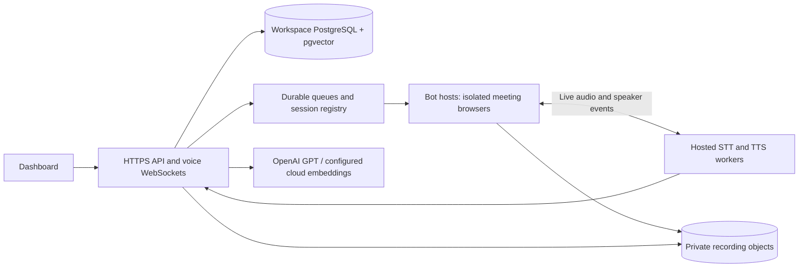

# MeetPilot: SaaS Deployment, Scaling, and Launch Plan

**Prepared: 8 October 2026.** Hosting limits were checked against official documentation on this date. Architecture observations refer to the current repository. Prices, capacity targets, and marketing experiments labeled as proposals are planning assumptions, not measured results or provider quotations.

**Founder-confirmed direction:** the final product is hosted web SaaS. Local
services are temporary development choices because the current budget is limited.
Production text intelligence will replace Ollama with OpenAI GPT APIs. No customer
will need to install this stack. The complete requested feature backlog is in
[Feature_Roadmap.md](Feature_Roadmap.md); implemented provider configuration and
the controlled GPT/embedding migration are in [Cloud_AI.md](Cloud_AI.md).

## 1. Recommendation

MeetPilot can become a SaaS, but the repository is currently a development stack with useful product features, rather than a production service with billing, capacity management, and operational guarantees.

**Start with a free hosted website and a small, invitation-only pilot.** Use Cloudflare Pages for the React frontend and Clerk for authentication. Run meeting bots and AI on existing suitable hardware during scheduled demonstrations, or evaluate an eligible Oracle free VM. Move to a paid Linux machine once customers need dependable availability.

There is no verified, dependable, entirely free hosting combination for this complete workload: persistent Chromium meeting bots, real-time speech, databases, queues and recordings. Free database and website hosting do not supply that compute. Replacing Ollama with GPT APIs removes the need to host that LLM but introduces metered inference costs; hosting free tiers do not make GPT API use free. Check [OpenAI pricing](https://developers.openai.com/api/docs/pricing) before choosing a model/budget.

Since the development PC has already overheated, it should not become the permanent public production server. A static demo and waitlist can stay online while that machine is off.

### Proposed decisions

| Decision | Initial choice |
| --- | --- |
| First customers | Small software agencies and product teams with recurring project meetings |
| Initial product promise | Evidence-linked meeting summaries, confirmed assignments, and searchable workspace knowledge |
| Availability | Scheduled private pilot initially; always-on service after production checks |
| Frontend | Cloudflare Pages |
| Authentication | Existing Clerk integration; workspace permissions remain in MeetPilot |
| Compute | Existing spare hardware for demos; free ARM experiment only if compatible; paid x86-64 Linux for dependable beta |
| Initial capacity policy | One concurrent live meeting globally until measured; quotas must be implemented |
| Deployment method | Docker Compose on one host initially |
| Production text AI | OpenAI GPT through the shared provider interface; Ollama for development only |
| First revenue model | Workspace subscription with included meeting minutes and a concurrency limit |

## 2. What this repository actually runs

The current implementation uses **self-hosted Vexa Lite as the meeting browser engine**, with MeetPilot's custom bridge and local intelligence. It was restored after the earlier native joining difficulties. It should not be described as Vexa-free.

| Component | Current implementation | Deployment implication |
| --- | --- | --- |
| Dashboard | React + Vite | Build static assets; host separately from the backend |
| API | FastAPI, SQLAlchemy, Clerk JWT authentication | Persistent HTTPS service with authenticated WebSockets |
| Main database | PostgreSQL 16 + pgvector | Durable storage, backups, tenant isolation |
| Background processing | Celery + Redis | Persistent workers; queue recovery and job idempotency |
| Meeting bridge | Celery `meeting_bot` queue, currently concurrency 1 | Long-running jobs need dedicated capacity |
| Meeting engine | Pinned Vexa Lite v012 image, custom `deploy/vexa` overlay | Chromium, Xvfb, PulseAudio, networking, browser session isolation |
| Engine infrastructure | Separate PostgreSQL 17, Redis, S3-compatible recording storage | Keep engine credentials and data separate from application access |
| Speech recognition | Local faster-whisper; default `base` model | CPU/RAM demand grows with live streams |
| Intelligence | Ollama `qwen3:4b-instruct` development default; selectable OpenAI Responses adapter | Production GPT model/key, cost limits and measured latency; no paid default activation |
| Retrieval | Ollama `nomic-embed-text-v2-moe` default; selectable OpenAI embeddings at 768 dimensions | Reindex on model/provider change; index size, queues and authorized retrieval |
| Speech synthesis | Local Piper, with fallback; bundled English voices | Voice models, latency, and redistribution licensing need review |
| Application recordings | Local filesystem storage provider | Shared object storage is required before independent worker hosts |

Relevant source files include `docker-compose.yml`, `backend/app/services/vexa_client.py`, `backend/app/workers/vexa_meeting.py`, `backend/app/services/storage.py`, and the `pilot_*` services.

### Privacy language to use accurately

Describe the product as hosted processing with workspace-controlled access and
inspectable source evidence. The current development models run on the developer's
hardware; production speech runs on hosted workers and text may be sent to OpenAI.
Document actual subprocessors and retention settings. **Do not advertise the live
product as 100% offline**, or imply that SaaS audio stays on a customer's device.

## 3. Free hosting options and their limits

These services cover different pieces; they are not interchangeable full-stack hosts. Check account eligibility, current terms, regions, and the provider console again before provisioning. Some free allowances require a payment method and can incur charges beyond the allowance.

| Service | Useful free allowance | How it fits MeetPilot | Limitation |
| --- | --- | --- | --- |
| Cloudflare Pages | 500 builds/month, one simultaneous build; 25 MiB per static file | Landing page and built React dashboard | Does not run our Docker bot/AI stack. [Official limits](https://developers.cloudflare.com/pages/platform/limits/) |
| Clerk Hobby | 50,000 monthly retained users per app; fixed 7-day session lifetime | Existing authentication | MRU is not MAU; production auth configuration and feature limits still apply. [Pricing](https://clerk.com/pricing) |
| Supabase Free | 500 MB database, 1 GB file storage, 5 GB egress; up to two active projects | Optional small main application database | Pauses after one week of inactivity; automatic backups are not included. [Pricing](https://supabase.com/pricing) |
| Cloudflare R2 Standard | 10 GB-month, 1 million Class A operations, 10 million Class B operations per month; internet egress free | Private recordings and document objects | Requires a new application storage adapter; usage beyond allowances is billable. [Pricing](https://developers.cloudflare.com/r2/pricing/) |
| Oracle OCI Always Free | Ampere ARM allowance equivalent to 2 OCPUs and 12 GB RAM; 200 GB total boot/block storage | Experimental small compute host | Capacity can be unavailable; idle instances can be reclaimed. ARM compatibility and performance are unverified. [Official allowance](https://docs.oracle.com/en-us/iaas/Content/FreeTier/freetier_topic-Always_Free_Resources.htm) |

Supabase supports [pgvector](https://supabase.com/docs/guides/database/extensions/pgvector), so the main database can retain vector retrieval. Use the backend's server-side database connection with TLS. Do not expose database credentials or enable an unrestricted browser database API. Application authorization must remain enforced for every workspace query.

**Important OCI correction:** older guides often quote 4 CPUs and 24 GB. The documentation checked for this plan states the smaller allowance in the table. Verify the tenancy's actual allowance instead of copying an old tutorial.

### Options that do not solve our compute problem

- **Render Free:** web services sleep after 15 minutes without inbound traffic, local files are ephemeral, and free PostgreSQL expires after 30 days. This is unsuitable for our durable recording and model workload. [Free service documentation](https://render.com/docs/free)
- **Railway Free:** currently a $5/30-day trial followed by $1 monthly credit, with post-trial limits including 0.5 GB RAM per service. This cannot hold our complete AI stack. [Pricing and limits](https://railway.com/pricing)
- **Vercel Hobby:** restricted to personal, non-commercial use. Choose hosting with appropriate commercial terms for the SaaS. [Hobby terms](https://vercel.com/docs/plans/hobby)
- **Ordinary Cloudflare Workers:** the free runtime has 128 MB memory and 10 ms CPU time per request. It is useful for small edge functions, rather than our long-running Python inference and Chromium services. [Runtime limits](https://developers.cloudflare.com/workers/platform/limits/)

Trial credits can fund experiments. They should not be the basis of a permanent zero-cost business model.

## 4. Three practical deployment paths

### Path A: zero additional hosting spend, scheduled demonstrations

1. Publish the landing page and dashboard shell on Cloudflare Pages.
2. Keep a sanitized demonstration recording and sample workspace; clearly identify sample data.
3. Use existing suitable hardware for API, databases, workers, and AI only during scheduled demonstrations.
4. Expose only the authenticated API through HTTPS. Never expose noVNC, Redis, PostgreSQL, Ollama, or the Vexa administrative gateway.
5. Restrict access to invited testers. State when processing is available and display an honest unavailable state when compute is off.

Cloudflare Quick Tunnels are an option for temporary demos, but have no SLA, a 200 in-flight request limit, and do not support SSE. A stable named tunnel/custom domain requires separate configuration; validate our WebSockets through the chosen proxy. [Tunnel limitations](https://developers.cloudflare.com/tunnel/get-started/quick-tunnels/)

This path has electricity, internet, hardware wear, and operator costs even if the hosting invoice is zero. It does not provide always-on service.

### Path B: experimental free cloud alpha

Evaluate OCI Ampere availability and inspect every pinned image's platform support before selecting ARM. In particular, the Vexa Lite image and native audio dependencies must pass a real ARM smoke test. Do not assume emulating an x86 browser image will meet real-time performance requirements.

Begin with uploaded recordings and queued analysis. Test live STT, TTS, and a single bot only after measuring memory and processing latency. Disable batch jobs while live audio is active. Treat this host as experimental until an entire meeting, recovery, and restore test passes.

If compatibility or CPU headroom fails, keep the free website and use Path A or C. Splitting the database onto a managed free service can reduce local memory demand, but introduces connection, latency, and operational work.

### Path C: first dependable commercial beta

Use a paid x86-64 Linux host near the initial customers, with private container networking, encrypted backups, HTTPS, and resource limits. A **4–8 vCPU / 16 GB RAM** machine is a starting benchmark candidate; **8 vCPU / 32 GB** offers more room for experiments. Neither specification is a verified concurrency guarantee.

Initially keep the two database instances and queue services on that host, with off-host backups. Put the frontend on Pages. Add private object storage when its adapter is implemented. Move databases and inference to separate machines as measurements justify it.

Select a provider using an actual quote for CPU class, sustained performance, disk, region, bandwidth, and backup costs. Shared vCPU numbers alone do not predict Whisper or Qwen latency. Start with one host and Compose; Kubernetes can wait.

## 5. Deployment preparation for this codebase

### Frontend

Use `frontend` as the Pages project root, build with `npm run build` after dependency installation, and publish `dist`, following the [Vite deployment guide](https://developers.cloudflare.com/pages/framework-guides/deploy-a-vite3-project/).

Set these **at build time**:

```text
VITE_API_BASE_URL=https://api.YOUR_DOMAIN
VITE_CLERK_PUBLISHABLE_KEY=YOUR_PRODUCTION_PUBLISHABLE_KEY
```

`VITE_*` values are public browser configuration. Never place private Clerk keys, bot tokens, or database URLs in them. Validate SPA navigation, `/workspace` refresh, HTTPS microphone permissions, and secure WebSocket connections after deployment.

### API, workers, and engine

Prepare a separate production Compose configuration. The current file has development source mounts, example database credentials, broadly exposed local ports, and a floating Ollama image; it should not be uploaded unchanged as a production release.

Required configuration includes:

- Production Clerk secret, JWKS URL, and issuer corresponding to the production instance.
- Exact allowed frontend origins in `CORS_ORIGINS`; appropriate JWT audience/authorized-party validation.
- Private `DATABASE_URL`, `REDIS_URL` and Celery broker/result connections.
- Production text selection: `AI_PROVIDER=openai`, explicit `OPENAI_CHAT_MODEL` and server-only `OPENAI_API_KEY`; separate embedding choice and controlled reindex. No secret belongs in `VITE_*` configuration.
- Hosted speech selection: `TRANSCRIPTION_PROVIDER=local` runs Whisper on our server, alongside Piper, until a speech API adapter is evaluated. Production customers install neither. Remove Compose's Ollama dependency when both chat and embeddings have migrated.
- Private Vexa bridge credentials and service-to-service URLs from the existing setup flow; do not reuse localhost/public administrative URLs for multi-host routing.
- Durable model, audio, database, and browser-profile volumes with restricted access.

Provision hosted speech models/voices during controlled deployment. Configure GPT
project limits and model access before enabling API inference. Warm speech models
outside active calls and measure cold starts. Keep development Ollama provisioning
separate from the production provider choice.

Enable persistence/authentication for the main Redis queue: its current development service has neither a durable volume nor an AOF configuration. Set process concurrency, CPU/memory limits, browser shared memory, restart policies, and log rotation.

### Migrations and release gates

Run compilation, focused permission tests, frontend checks, and an image build in CI. Deploy staging first. Back up both application and engine databases before running migrations. Run migrations once per release rather than simultaneously from every API replica.

The existing startup combines `app.database.bootstrap` with Alembic. A production release needs a reviewed initialization/migration process tested both against a fresh database and an existing one.

The recent language and workspace-approval migrations have not been applied to the stopped local Docker stack. Passing host compilation does not verify a PostgreSQL migration or a cloud deployment.

## 6. Engineering work required before public signup

| Priority | Deliverable | Acceptance condition |
| --- | --- | --- |
| P0 | Workspace quotas and capacity admission | Reserve a bot slot atomically before dispatch; reject or schedule overload clearly; release it on every terminal path |
| P0 | Usage accounting | Idempotent ledger of meeting seconds, transcription/AI work, storage, and workspace billing period |
| P0 | Restart recovery | No duplicate bots/tasks after retries; lost bridge leases and genuine meeting endings classified correctly |
| P0 | Deployment isolation | No public database, Redis, model server, browser console, or engine-admin endpoint |
| P0 | Backups and restore | Restore application records and recordings on another host; document recovery procedure |
| P0 | Privacy and deletion | Participant notice, customer recording policy, retention controls, deletion/export across engine and application stores |
| P1 | Private object storage | Workspace-prefixed keys, authenticated authorization, short-lived signed URLs, bounded multipart uploads, deletion cleanup |
| P1 | Subscription billing | Server-verified payment webhooks, idempotency, plan changes, grace periods, cancellations, and quota enforcement |
| P1 | Abuse protection | Rate limits for joins, uploads, voice connections, and AI requests; bounded document ingestion |
| P1 | Auditing and support | Manager-action audit trail, redacted logs, usage view, incident diagnostics |

The new workspace approval and role checks are implemented in source, with focused tests. They do not replace production abuse controls, billing, or an independent security review. See `Workspace_Access_Audit.md` for the exact permissions and identity limitations.

### A concrete upload issue

The application accepts audio up to approximately 250 MB in its current configuration. Cloudflare's Free/Pro proxied request limit is 100 MB, so large uploads would fail through that route. Implement direct, authorized multipart object uploads, or lower the advertised limit to fit the complete HTTP request. [Request limits](https://developers.cloudflare.com/workers/platform/limits/)

Adding an R2 URL to configuration is insufficient: `storage.py` currently implements only local filesystem storage. Update recording playback, processing downloads, range requests, cleanup, and retention together with the adapter.

## 7. How to scale without losing audio or tenant isolation

### Stage 1: one host, a small pilot cohort

Invite 5–10 teams gradually, but initially admit only one live meeting at a time globally. Team count is not concurrent-call capacity. Implement that cap explicitly; Celery concurrency 1 alone is not a product-wide quota.

Separate live audio work from uploaded-recording analysis and document embedding. Pause or throttle batch processing when live latency increases. Limit each workspace's minutes, upload size, and retention.

Measure:

- Join success and time to admission, distinguishing host rejection/sign-in requirements from bot failures.
- Audio backlog and dropped frames; STT processing time divided by incoming audio duration.
- Speech-end to final transcript, wake acknowledgment, first TTS audio, and interruption latency.
- CPU, resident RAM, inference queue length, disk growth, database connections, and failure recovery.
- Task assignment accuracy and evidence coverage using reviewed meetings.

Proposed pilot goals: at least 95% successful joins on supported, host-admitted test calls; p95 final transcript within 3 seconds of speech end; cached wake acknowledgment within 1.5 seconds of a recognized wake phrase. These are acceptance targets to test, not current claims. Measure wake recognition delay separately from playback delay.

### Stage 2: separate API, inference, and bot hosts



This is a **target architecture**, not the current multi-host implementation.

- Assign each meeting to a specific engine node. Persist its node/engine identifiers so stop, status, transcripts, and voice output reach the correct browser. The current single gateway configuration needs extension.
- Use a shared authenticated session registry, leases, and idempotency keys. An API replica restart must not create a second bot or erase session ownership.
- Keep inference outside HTTP event loops. Avoid loading duplicate Whisper models in every API process; use shared inference workers with bounded queues.
- Scale browser slots from measured per-call CPU/RAM and inference capacity. Scale API replicas based on HTTP/WebSocket demand separately.
- Preserve workspace checks when retrieving context, subscribing to events, producing signed audio links, and executing Pilot actions. Display names must never become authorization credentials.
- Use connection pooling and inspect vector-query plans before adding database replicas or larger vector indexes.

The two Redis and PostgreSQL services have different roles and versions. They can share a physical server initially, but consolidating them requires deliberate schemas, users, ACLs, and migration testing.

### Stage 3: dependable operation

Add rolling/draining deployments so active calls are not terminated, inference backpressure, regional placement, scheduled capacity, and automated recovery. Introduce orchestration only when managing multiple hosts becomes harder than operating it.

Never kill an active meeting to scale down. Stop accepting new calls on a draining node and retire it after sessions finish. Multi-region service requires an explicit customer data-region policy.

## 8. Costs, limits, and unit economics

Development models avoid metered API charges while consuming hardware and operator
time. Hosted production additionally budgets GPT/embedding usage and any selected
speech APIs; usage must be attributed and capped per workspace before public signup.

```text
Monthly cost = compute + durable storage + backups + networking
             + GPT/embeddings/speech APIs + authentication/email/monitoring
             + payment costs + support

Cost per processed meeting hour = attributable monthly service cost
                               / successfully processed meeting hours

Gross margin = (revenue - cost of delivering the service) / revenue
```

Include idle capacity, failed calls, retries, document ingestion, model downloads, and support when evaluating profitability.

### Illustrative budget, not a hosting quote

| Phase | Planning envelope | What it means |
| --- | --- | --- |
| Static website | $0 hosting within free allowances | Domain registration and other services may still cost money |
| Scheduled demo | $0 additional cloud compute if existing hardware is used | No always-on promise; hardware and electricity still cost money |
| Small commercial beta | Provisional $40–$100/month infrastructure envelope, plus metered AI | Replace with current compute/storage quotes, model prices, token volumes and real meeting benchmarks |
| Growing service | Capacity- and usage-driven | Separate speech/bot nodes and cloud inference budgets; GPU only if measured need justifies it |

For example, a hypothetical $60 monthly delivery cost spread over 100 successful meeting hours is $0.60/hour, while the same fixed cost at 20 hours is $3/hour. This arithmetic does not establish how many hours that host can process.

### Storage grows quickly

16 kHz mono PCM16 is 32,000 bytes/second: approximately **115.2 MB per hour**. Keeping 100 hours of raw audio simultaneously requires around **11.52 GB**, before other files. At 24 kHz, that becomes 172.8 MB/hour. Compression changes actual usage; measure the stored format.

A 768-element float32 embedding contains 3,072 raw bytes. 100,000 embeddings alone occupy about 307 MB, before rows, text, indexes, and database overhead. Small free database allowances will not support unlimited workspace history.

Proposed initial policy: short raw-audio retention, longer transcript retention, customer-controlled deletion, and bounded document indexing. Establish actual periods with pilot customers before writing promises into a contract.

## 9. Positioning and marketing

### Choose a narrow initial audience

Start with Indian software agencies and small product teams, particularly managers who run repeated standups, sprint reviews, and client calls. This is a proposed niche based on our current workflow and language direction, not validated demand.

Interview 10–15 managers before choosing the final offer. Ask how they track decisions, assign follow-ups, search old agreements, and handle mixed-language meetings. Ask what they would pay to solve the most expensive recurring problem.

Suggested positioning:

> MeetPilot turns project meetings into evidence-linked decisions, accountable tasks, and searchable team memory, with manager-controlled workspace access.

Lead with an outcome: finding the exact budget agreement, seeing who owns a follow-up, or recovering a decision with its timestamp. Use two-way voice as an opt-in beta feature until joining, wake responsiveness, barge-in, and audible replies consistently pass real meetings.

### Differentiation to validate

- Speaker quotes and timestamps supporting summaries and actions.
- Manager-confirmed assignments and approved workspace membership.
- Questions across meeting history and company documents.
- Hindi/Bengali transcript support with optional Hinglish/Benglish presentation.
- Customer-controlled inference and a future self-hosted edition for teams that want to operate their own infrastructure.

Language selectors and Romanized rendering are implemented, but transcription quality and code-switching require representative audio tests. Bundled neural voices are English. Do not promise native Hindi/Bengali voice responses or perfect transliteration yet.

Avoid claims such as “zero hallucinations,” “better than every meeting bot,” “100% offline SaaS,” or enterprise compliance certifications without supporting evidence. Explain when the assistant is uncertain and give customers evidence they can inspect.

### First customer acquisition

1. Create a short consented demo: a meeting decision becomes a quoted summary, then a manager confirms an assignee, then a teammate finds the answer later.
2. Recruit 5 design partners through existing contacts, agency communities, and personalized founder outreach. Ask permission before sharing their recordings or testimonials.
3. Offer assisted onboarding and an explicit pilot period. Attend the first setup to learn actual joining and workflow friction.
4. Publish practical content around project handoffs, multilingual standups, and recovering decisions. Show the workflow rather than a broad list of AI features.
5. Request referrals after a team repeatedly uses the service. Delay paid advertisements until activation and retention are measured.

No outreach messages, posts, or campaigns have been sent as part of this plan.

### Pricing experiments

Charge by workspace with a pool of minutes; use concurrent bot slots as a separate limit. Seats alone do not track audio inference cost.

| Proposed offer | Suggested experiment | Limits to implement first |
| --- | --- | --- |
| Trial | 60–90 minutes total, invitation-only | No recurring unlimited free bot usage; one slot when capacity is available |
| Founding Team | Test willingness to pay around ₹1,499–₹2,499/workspace/month | Small team, 300 included minutes, one concurrent call, capped storage |
| Growing Team | Test around ₹3,999–₹5,999/workspace/month | Larger minute pool; second concurrent call only after capacity testing |
| Self-hosted pilot | Setup/support quotation | Customer owns compute; support scope, updates, and licenses reviewed |

These are pricing hypotheses in INR, not committed plans or proven profitable rates. Compare actual delivery cost in the same currency before publishing. Set overage prices only after measuring usage and payment costs. Never silently auto-charge additional minutes.

Track activation (first useful meeting and confirmed action), weekly active workspaces, repeated meeting use, manager corrections, conversion, churn, support time, and cost per successful hour. Useful retained teams matter more than signup counts.

## 10. Privacy, trust, and dependency review

Before paid launch, prepare an accurate privacy policy, terms, retention policy, subprocessor list, recording notice, and customer deletion/export process. Review applicable recording, privacy, and payment obligations for the markets served before setting legal promises.

Have the assistant identify itself visibly. Require the customer to obtain appropriate participant permission. Do not bypass meeting admission or account security; host restrictions remain valid even when the bot works correctly.

Encrypt secrets and browser account cookies, separate workspace sessions, redact logs, and restrict operational access. Backups need the same protection as live databases. A self-hosted model alone is not a security or compliance certification.

Inventory licenses for code, native dependencies, model weights, and voices before distributing containers or a self-hosted edition. Upstream Vexa currently publishes an [Apache 2.0 license](https://raw.githubusercontent.com/vexa-ai/vexa/main/LICENSE); confirm notices for the exact pinned version. Our requirements pin `piper-tts==1.8.0`, and maintained Piper publishes [GPL-3.0](https://github.com/OHF-Voice/piper1-gpl). Review the exact package, its native components, and each voice model's license. Do not assume the repository's MIT license covers all dependencies or settle distribution obligations from this planning document.

## 11. Proposed 30 / 60 / 90-day roadmap

Timing is a planning sequence, not a commitment; advance when the acceptance gate passes.

| Period | Product and engineering | Business milestone |
| --- | --- | --- |
| Days 1–30 | Staging release, migration verification, quotas, recovery, permission checks, backup restore, real meeting benchmarks | Interview 10–15 managers; onboard 3–5 design partners; publish free website |
| Days 31–60 | Stable one-host beta, private storage adapter, usage ledger, retention/export, support diagnostics | Obtain repeated weekly usage and test paid pilot pricing |
| Days 61–90 | Billing and plan enforcement; separate inference or bot host if measurements require it; deployment draining | Launch limited commercial signup only when reliability and delivery cost are understood |

### Launch gate

- [ ] Fresh and existing PostgreSQL migrations pass; restoration tested.
- [ ] Owner, manager, teammate, pending applicant, and removed-member access checked in staging.
- [ ] Full meeting: admission → audible capture → transcripts → grounded answer → audible reply → natural ending → final analysis.
- [ ] Network interruption, worker restart, rejected admission, expired session, and full disk recover or fail clearly.
- [ ] Real English, Hindi, Bengali, and mixed-language samples reviewed before language-specific marketing claims.
- [ ] Quotas, capacity reservations, and billing cannot be bypassed through retries or concurrent requests.
- [ ] Private objects, cookies, secrets, and operational ports protected.
- [ ] Customer notices, retention/deletion, dependency inventory, monitoring, and support process ready.

## 12. Immediate next steps

1. **Put the website online for free** and collect pilot interest; keep the local machine off outside scheduled verification.
2. **Verify one complete meeting on a measured Linux deployment**, including migration, ending analysis, recovery, and voice playback. Choose free ARM only after compatibility succeeds.
3. **Implement quotas, usage accounting, storage, and release safety** before public signup. Use the first paying pilots to fund stable compute.

The intended first commercial architecture is **hosted React + Clerk + a properly
configured Linux API/bot/speech host + OpenAI GPT + private PostgreSQL/pgvector and
object storage**, with durable queues and off-host backups. Start with services
within eligible free allowances where suitable, and fund persistent compute/API
usage from a bounded pilot budget. The early goal is reliability for a few teams;
capacity expands from measured demand. See Feature_Roadmap.md for the full product
scope rather than treating the initial 90 days as the complete feature list.

This document creates a plan only. It does not provision services, start Docker, apply migrations, or establish production capacity.
